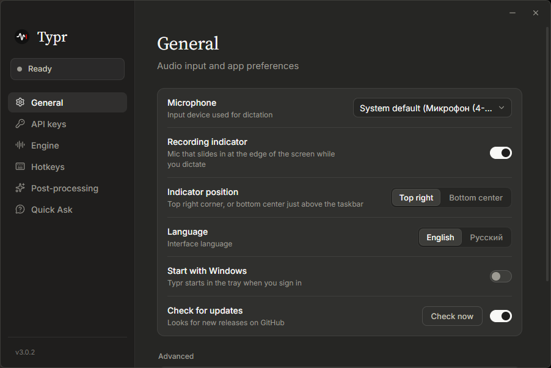

<p align="center">
  
</p>

<h1 align="center">Typr</h1>

<p align="center">
  <b>English</b> · <a href="README.ru.md">Русский</a>
</p>

Typr is a lightweight desktop dictation app for Windows. Press a global hotkey, speak, and the recognized text is pasted into whatever window is active. It can also answer: ask an AI about the text you selected, or chat with it by voice in a small window at the edge of the screen.

<p align="center">
  
</p>

## Features

### Dictation

- **Global hotkey** in two modes (toggle or push to talk): a key combination or a single mouse button (middle or side). Both hotkeys, for dictation and for Quick Chat, are set in the Hotkeys section.
- **Recording indicator:** a small mic shows up only while you dictate (recording, transcribing, pasting) and hides again. It slides down from behind the top edge in the top-right corner, or up from behind the taskbar at the bottom center, whichever you choose.
- **Clean clipboard:** the dictated text is pasted through the clipboard and stays out of the Windows clipboard history.
- **Space after the text**, so the next phrase doesn't stick to the previous one.

### Speech recognition

- **Local recognition** with [transcribe.cpp](https://github.com/handy-computer/transcribe.cpp): Parakeet TDT 0.6B v3, Whisper Large v3, Large v3 Turbo and Medium run on your computer, the audio never leaves it. They run on the GPU through Vulkan (NVIDIA, AMD or Intel) or on the CPU. Models are downloaded and deleted in the settings, and an idle model leaves memory by itself.
- **Cloud speech-to-text providers:** Groq (Whisper Large v3/v3 Turbo), [Polza.AI](https://polza.ai/), [AssemblyAI](https://www.assemblyai.com/) (Universal-3.5 Pro/Universal-2), and any OpenAI-compatible endpoint. Recordings are sent as FLAC where the service takes it, over a connection opened while you speak.
- **Local fallback:** if the cloud fails, a downloaded local model transcribes the dictation; the next one goes to the cloud again.
- **Language of the speech:** detected automatically or fixed (Russian, English and more), which helps short phrases.

### Text

- **Post-processing:** an AI model (Gemini, OpenRouter, Groq or Polza) polishes the text before it is pasted, in the Chill, Proper or your own style.

### AI assistant

- **Quick Ask:** select text in any app, press the dictation hotkey and ask about it out loud ("translate this", "what does this error mean"). The recording indicator unfolds into a small window with the answer, and the app you were in keeps the focus; press the hotkey again to ask a follow-up in the same conversation. Off by default.
- **Quick Chat:** a hotkey of its own (Ctrl+Alt by default) opens the same window as a chat with the AI, no selection needed. Ask out loud with the dictation hotkey: your questions appear on the right, the answers below them, and text selected before a question goes along with it. The same hotkey or the cross closes the chat. The hotkey can be two modifiers alone (they fire when let go, so Ctrl+Alt+Delete and other shortcuts don't trigger it), a key combination or a mouse button. Off by default.
- **Web search:** with an [Exa](https://exa.ai/) key, the model searches the web when a question needs fresh facts ("Search…" blinks meanwhile) and names its sources as links that open in the browser.
- **Answers you can use:** formatted text, lists and code; a click on an answer copies it. Gemini, OpenRouter, Groq or Polza answers, with the model you pick.

### App

- **API keys in one place:** each service's key is entered once, in API keys; the other sections only pick the service and the model. Keys from older versions move there by themselves.
- **Setup wizard** on the first launch: the interface language, how to recognize speech (with a recommendation for this computer), the model or key, the hotkey.
- **Tray menu:** paste the last dictation again, switch the engine, open the settings, turn the hotkeys off (e.g. while gaming).
- **Starts with Windows** (optional) and **checks GitHub for new releases.**
- **Tiny footprint:** about 5 MB of RAM in the tray! The settings window's WebView is released when it's closed, and the recording indicator is drawn natively.
- **Developer mode:** a live log of everything the app does, for troubleshooting. There you can also keep WebView2 in the background: Quick Ask, Quick Chat and the settings window open faster, at the cost of more RAM while idle (about 140 MB).
- **English and Russian interface**, dark and minimal, in the Anthropic style, with its own window buttons instead of the system title bar.

## Building

The installer is built by GitHub Actions (`.github/workflows/build.yml`) when a `v*` tag is pushed or the workflow is started manually:

```bash
git tag v3.0.0
git push origin v3.0.0
```

Local development needs [Rust](https://rustup.rs/) and [Node.js](https://nodejs.org/) 20+:

```bash
npm install
npm run tauri dev
```

Built with [Tauri 2](https://tauri.app/) (Rust) and vanilla TypeScript.

## Credits

- Original project by [albertshiney](https://github.com/albertshiney/typr)
- Fork maintained by [neodym121](https://github.com/neodym121), improved together with [Claude](https://claude.com/claude-code) (Anthropic)

## License

[MIT](LICENSE)
