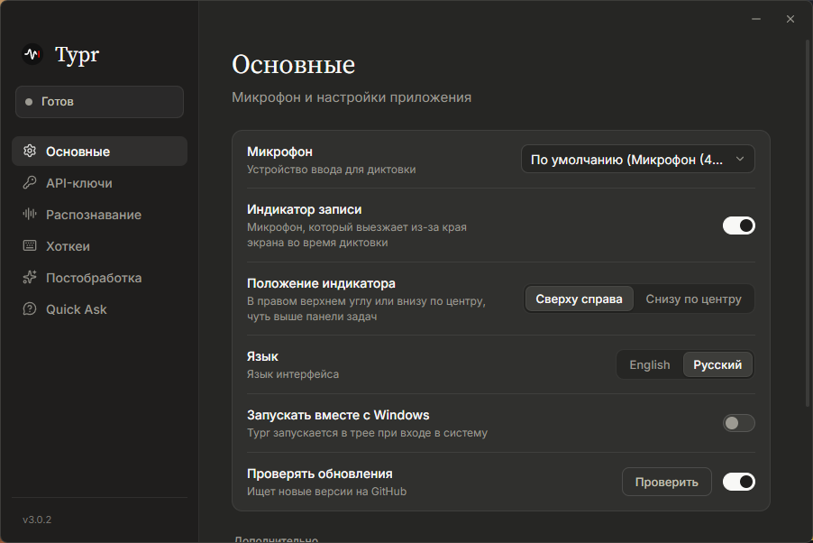

<p align="center">
  
</p>

<h1 align="center">Typr</h1>

<p align="center">
  <a href="https://github.com/neodym121/typr-updated/releases/latest"></a>
  <a href="https://github.com/neodym121/typr-updated/releases/latest"></a>
  <a href="https://tauri.app/"></a>
  <a href="https://github.com/neodym121/typr-updated/stargazers"></a>
  <a href="https://github.com/neodym121/typr-updated/blob/main/LICENSE"></a>
</p>

<p align="center">
  <a href="https://slint.dev/"></a><br />
  Окно Quick Ask сделано на <a href="https://slint.dev/">Slint</a>
</p>

<p align="center">
  <a href="README.md">English</a> · <b>Русский</b>
</p>

Typr — лёгкое приложение для голосового ввода на Windows. Нажимаешь глобальный хоткей, говоришь, и распознанный текст вставляется в активное окно. А ещё оно умеет отвечать: спросите ИИ о выделенном тексте или поговорите с ним голосом в маленьком окне у края экрана.

<p align="center">
  
</p>

## Возможности

### Диктовка & Текст

- **Глобальный хоткей** в двух режимах (переключение или удержание): сочетание клавиш или одна кнопка мыши (средняя или боковая). 
- **Локальное распознавание** через [transcribe.cpp](https://github.com/handy-computer/transcribe.cpp): Parakeet TDT 0.6B v3, Whisper Large v3, Large v3 Turbo и Medium работают прямо на компьютере, звук никуда не уходит. Работают на видеокарте через Vulkan (NVIDIA, AMD или Intel) или на процессоре. Модели скачиваются и удаляются в настройках, неиспользуемая модель сама выгружается из памяти.
- **Облачные провайдеры распознавания:** Groq (Whisper Large v3/v3 Turbo), [Polza.AI](https://polza.ai/), [AssemblyAI](https://www.assemblyai.com/) (Universal-3.5 Pro/Universal-2), а также любой OpenAI-совместимый эндпоинт. Запись уходит в FLAC, где сервис его принимает, по соединению, открытому, пока вы говорите.
- **Постобработка:** нейросеть (Gemini, OpenRouter, Groq или Polza) дорабатывает текст перед вставкой в разных стилях.
- **Перевод** продиктованного текста на многие языки.

### ИИ-помощник

- **Quick Ask:** выделите текст в любом приложении, нажмите хоткей диктовки и спросите о нём вслух («переведи это», «что значит эта ошибка»). Индикатор записи разворачивается в маленькое окно с ответом, а фокус остаётся в приложении, где вы были. Окно рисует сам Typr, без браузерного движка: оно появляется примерно за 16 мс и занимает около 2 МБ ОЗУ.
- **Quick Chat:** отдельный хоткей (по умолчанию Ctrl+Alt) открывает то же окно как чат с ИИ. Тот же хоткей или крестик закрывает чат.
- **Поиск в интернете:** с ключом [Exa](https://exa.ai/) модель ищет в сети, когда вопросу нужны свежие факты.

### Приложение

- **API-ключи в одном месте:** ключ каждого сервиса вводится один раз в «Параметры → API-ключи» (ключ сервера, совместимого с OpenAI, — рядом с его адресом в «Распознавании»), в остальных разделах выбираются только сервис и модель.
- **Минимум памяти:** около 5 МБ ОЗУ в трее! WebView окна настроек выгружается после закрытия, а индикатор записи и окно Quick Ask рисуются нативно.
- **Режим разработчика:** живой лог всего, что делает приложение, для поиска проблем.
- **Интерфейс на русском и английском**, тёмный и минималистичный, в стиле Anthropic, со своими кнопками окна вместо системного заголовка.

## Сборка

Установщик собирает GitHub Actions (`.github/workflows/build.yml`) при пуше тега вида `v*` или при ручном запуске workflow:

```bash
git tag v3.3.0
git push origin v3.3.0
```

Для локальной разработки нужны [Rust](https://rustup.rs/) и [Node.js](https://nodejs.org/) 20+:

```bash
npm install
npm run tauri dev
```

Сделано на [Tauri 2](https://tauri.app/) (Rust) и чистом TypeScript; окно Quick Ask — на [Slint](https://slint.dev/).

## Авторы

- Оригинальный проект — [albertshiney](https://github.com/albertshiney/typr)
- Форк ведёт [neodym121](https://github.com/neodym121), доработан вместе с [Claude](https://claude.com/claude-code) (Anthropic)
- Окно Quick Ask: [Slint](https://slint.dev/) (лицензия Royalty-free 2.0)
- Иконки: [Lucide](https://lucide.dev/) (ISC); флаги: [Twemoji](https://github.com/jdecked/twemoji) (CC-BY 4.0)
## Лицензия

[MIT](LICENSE)
